# ⚡ Smart AI Agent Assistant (100% Free & Open-Source Stack)

A production-grade, modular AI application built with **Python**, **LangChain**, **ChromaDB**, **Streamlit**, and **Groq Cloud** (`llama-3.3-70b-versatile`).

This project integrates two cutting-edge components into a unified, responsive interface:
1. **Component 1: Advanced "Chat with your PDF" RAG Pipeline** with custom recursive chunking, fallback for corrupted/empty PDFs, ChromaDB distance metric handling (Cosine Similarity vs. Euclidean Distance), and strict hallucination guardrails.
2. **Component 2: Autonomous Tool-Calling AI Agent** with real-time Open-Meteo weather (zero API key required), stock price & financial calculator, and exponential backoff retry resilience.

---

## 🏗️ Architecture

```mermaid
flowchart TD
    subgraph UI ["Streamlit Web Interface (app.py)"]
        Tab1["Tab 1: 📄 PDF RAG Assistant"]
        Tab2["Tab 2: 🤖 Tool-Calling Agent"]
        Sidebar["Sidebar: Groq Key, Metric Toggle, Model Config"]
    end

    subgraph RAG ["Component 1: Advanced RAG Pipeline (rag_pipeline.py)"]
        PDF["PDF Ingestion (pypdf)"] --> Validation{"Validation: Empty / Corrupt / Encrypted?"}
        Validation -->|Invalid| FallbackMsg["Clean Diagnostic Fallback"]
        Validation -->|Valid| Chunker["Custom Recursive Chunking + Metadata"]
        Chunker --> Embed["Local Embeddings (all-MiniLM-L6-v2 ONNX)"]
        Embed --> ChromaDB["ChromaDB Vector Store (Cosine vs. L2)"]
        ChromaDB --> TopK["Top-K Relevant Chunks"]
        TopK --> Guardrail["Strict Hallucination Guardrail Prompt"]
        Guardrail --> GroqRAG["Groq LLaMA-3.3-70B Streaming"]
        GroqRAG --> CheckFound{"Context Contains Answer?"}
        CheckFound -->|No| Refusal["'I cannot find the answer in the provided document.'"]
        CheckFound -->|Yes| StreamResponse["Streaming Answer + Citations & Distance Scores"]
    end

    subgraph Agent ["Component 2: Tool-Calling Agent (agent_tools.py)"]
        UserPrompt["User Message"] --> Router["Groq Function Calling Agent"]
        Router --> Intent{"Intent Classifier"}
        Intent -->|Weather| WeatherTool["Open-Meteo Weather Tool (Free, No Key)"]
        Intent -->|Stock / Math| StockTool["Stock Price & Calculator Tool (yfinance + Math)"]
        Intent -->|General QA| DirectLLM["Direct Conversational Response"]
        WeatherTool --> Tenacity["Exponential Backoff & Rate Limit Retry"]
        StockTool --> Tenacity
        Tenacity --> ToolOutput["Structured Tool Result (JSON)"]
        ToolOutput --> FinalSynthesizer["Groq LLaMA-3.3-70B Final Answer"]
    end

    Tab1 --> RAG
    Tab2 --> Agent
```



---

## 🌟 Key Features

### 📄 Component 1: Advanced PDF RAG Pipeline
- **Corrupted / Empty PDF Fallback**: Gracefully detects corrupt PDF bytes, password locks, and image-only/scanned PDFs with zero text layers, displaying clear diagnostic errors instead of crashing.
- **Custom Recursive Chunker**: Splits text semantically using cascading separators (`\n\n`, `\n`, `. `, ` `) while attaching rich metadata (`page_num`, `chunk_id`, `char_count`, `source`).
- **Distance Metric Handling**:
  - **Cosine Similarity (`hnsw:space = 'cosine'`)**: Measures angular divergence ($1 - \frac{A \cdot B}{\|A\| \|B\|}$), making it invariant to token length. Ideal for natural language semantic similarity.
  - **Squared Euclidean Distance (`hnsw:space = 'l2'`)**: Measures straight-line spatial distance ($\sum (A_i - B_i)^2$), sensitive to vector magnitude and document segment length.
  - Interactive toggle in sidebar dynamically rebuilds or inspects vector indices with educational explanations.
- **Strict Hallucination Guardrails**:
  - Negative constraint prompt engineering: If the retrieved context does not contain enough factual evidence to answer, the LLM is strictly bound to respond verbatim:
    ```
    "I cannot find the answer in the provided document."
    ```
  - Zero speculation or outside knowledge hallucination.
- **Real-Time Streaming**: Streamed token-by-token using `st.write_stream` and Groq's high-speed inference engine (500+ tokens/sec).

### 🤖 Component 2: Tool-Calling AI Agent
- **Real-Time Weather Tool (Open-Meteo)**:
  - 100% free public weather API — **Zero API key required**.
  - Geocoding API converts city names to coordinates.
  - Forecast API retrieves temperature (°C/°F), humidity, wind speed, precipitation, and conditions mapped from official WMO codes.
- **Stock Price Calculator & Lookup Tool**:
  - Integrates `yfinance` to retrieve current market prices, day high/low, and 52-week trends.
  - Performs financial calculations (e.g. `shares * unit_price` for portfolio valuation, percentage changes, P/E ratio).
  - Built-in demonstration market dataset fallback if Yahoo Finance is rate-limited or offline.
- **Rate-Limit Resilience & Exponential Backoff**:
  - Uses `tenacity` retry decorator with exponential backoff on HTTP 429 and network timeouts.
  - Gracefully recovers from invalid arguments, division by zero, and unrecognized cities/tickers without crashing the agent loop.
- **Transparent Execution Panel**: Expandable UI inspects every tool call, arguments, execution duration (ms), and raw JSON results.

---

## 🔑 Free API Key Setup (Groq Cloud)

This application uses Groq's **100% Free Tier**:
1. Visit [https://console.groq.com/keys](https://console.groq.com/keys).
2. Sign in with your Google or GitHub account (no credit card required).
3. Click **Create API Key**, copy the generated key (`gsk_...`).
4. Paste the key into `.env`:
   ```bash
   GROQ_API_KEY=gsk_your_actual_key_here
   ```
   *(Or you can enter it directly in the Streamlit web sidebar at runtime)*.

---

## 🚀 Quick Start Guide

### 1. Prerequisites
- Python 3.10, 3.11, 3.12, or 3.13 installed.
- Internet connection (for Groq LLM, Open-Meteo, and Yahoo Finance).

### 2. Install Dependencies
Open your terminal inside this folder and run:
```bash
pip install -r requirements.txt
```

### 3. Run the Application
Run with Streamlit:
```bash
streamlit run app.py
```
*(On Windows, you can also simply double-click `run.bat`)*

The browser will automatically open at `http://localhost:8501`.

---

## 🧪 Running Automated Tests

Run the comprehensive unit test suite:
```bash
pytest -v tests/
```
Tests verify:
- Corrupted and empty PDF fallback exceptions (`test_corrupted_pdf_fallback`, `test_empty_pdf_detection`).
- Recursive text chunking and metadata preservation (`test_chunk_document_pages_metadata`).
- ChromaDB vector store initialization with Cosine Similarity and L2 Euclidean metrics (`test_chroma_vector_store_distance_metrics`).
- Hallucination guardrail prompt structure (`test_strict_guardrail_prompt_structure`).
- Open-Meteo weather tool execution and WMO code mappings (`test_weather_success_mock`).
- Stock calculator financial calculations and invalid ticker handling (`test_stock_calculator_shares_math`).
- Exponential backoff retry behavior on HTTP 429 rate limits (`test_api_retry_backoff_decorator`).
- Agent turn resilience on empty or invalid inputs (`test_run_agent_turn_empty_query`).

---

## 📁 Project Structure

```
smart-ai-agent/
├── app.py                  # Streamlit dual-tab interactive web interface
├── rag_pipeline.py         # PDF extraction, chunker, ChromaDB (Cosine/L2), Guardrails
├── agent_tools.py          # Weather tool, stock calculator, backoff retry, agent loop
├── config.py               # Settings, env vars, model defaults, metric definitions
├── requirements.txt        # Pinned compatible dependencies
├── run.bat                 # Convenient 1-click Windows launcher
├── .env.example            # Template for environment configuration
├── .env                    # Local environment config
├── .gitignore              # Ignores sensitive and cache files
├── README.md               # Documentation and architecture guide
└── tests/
    ├── test_rag.py         # Unit tests for RAG pipeline & ChromaDB
    └── test_agent_tools.py # Unit tests for agent tools & retries
```

---

## 🇮🇳 हिंदी में त्वरित निर्देश (Hindi Summary)

1. **फाइलें कहाँ हैं?**: सभी फाइल्स `smart-ai-agent` फोल्डर में तैयार हैं।
2. **पैकेजेज इनस्टॉल करें**:
   ```bash
   pip install -r requirements.txt
   ```
3. **Groq API Key डालें**:
   `https://console.groq.com/keys` से फ्री key लेकर `.env` फाइल में `GROQ_API_KEY=` के आगे लिख दें (या सीधे ऐप के साइडबार में पेस्ट करें)।
4. **ऐप शुरू करें**:
   ```bash
   streamlit run app.py
   ```
   या `run.bat` पर डबल-क्लिक करें।
